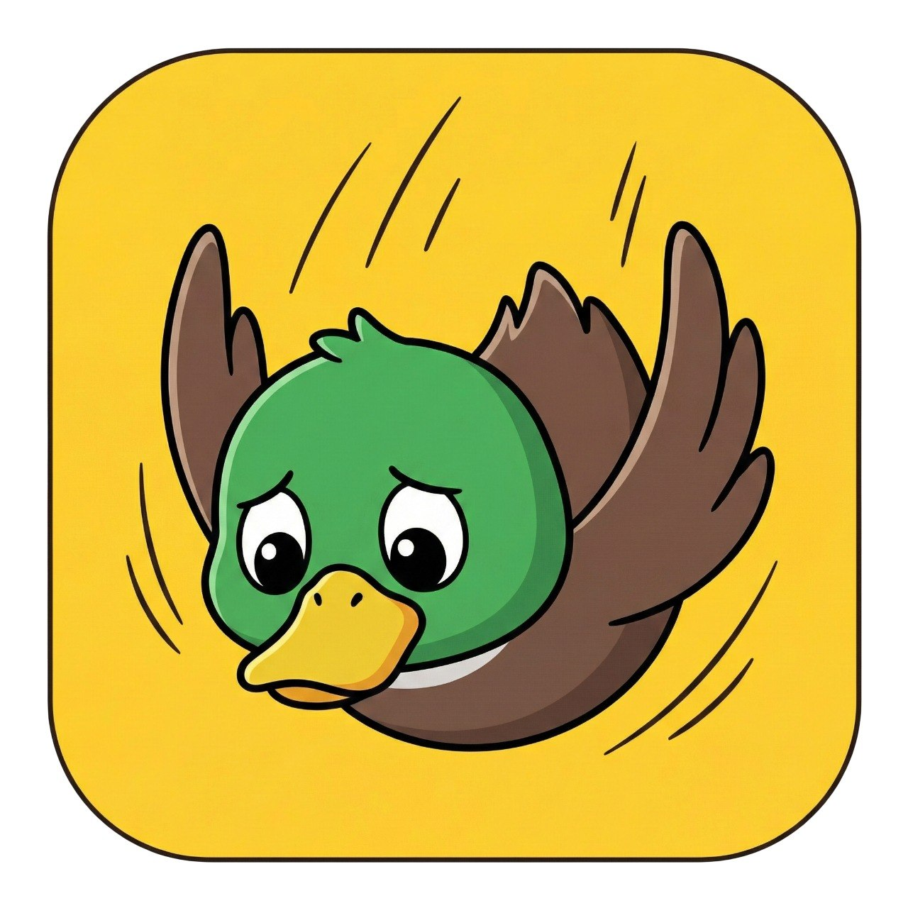
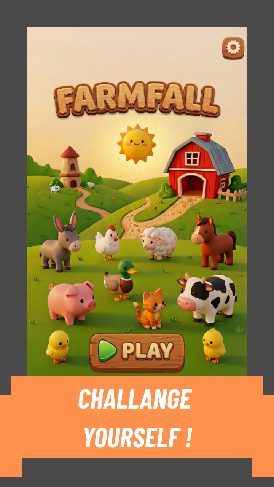
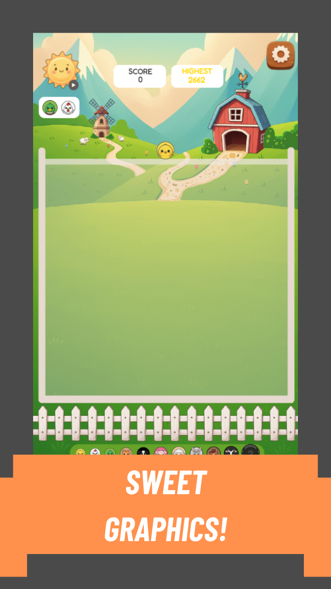
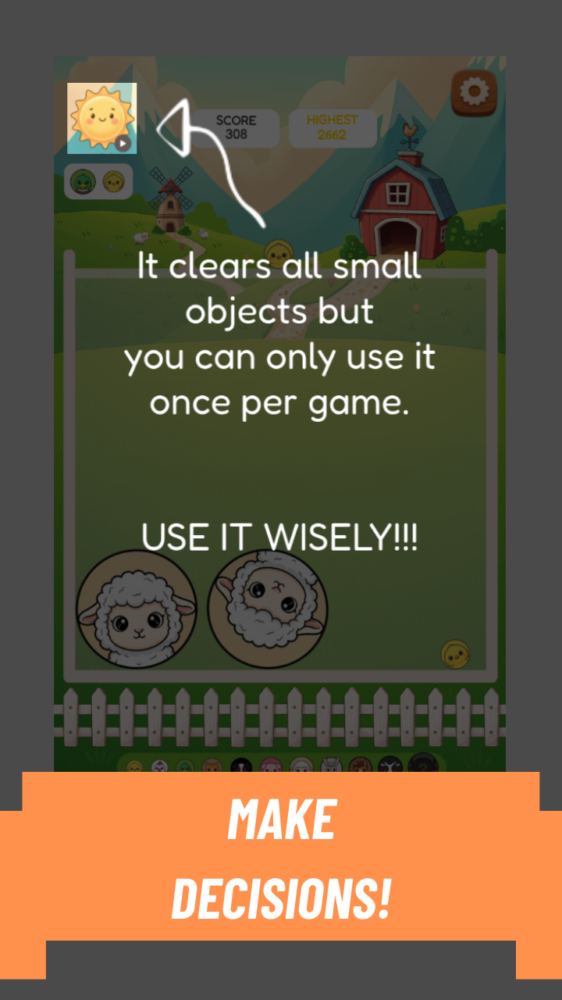
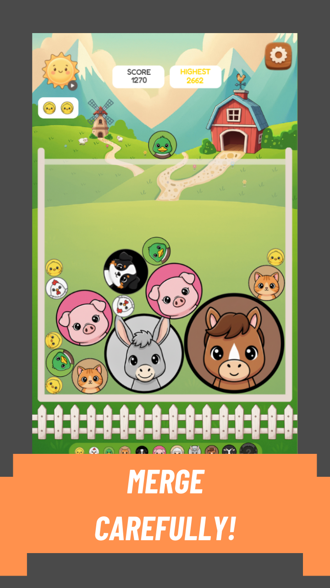
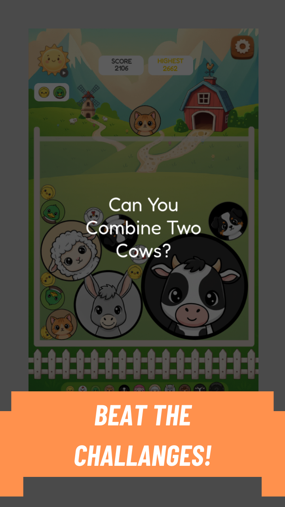
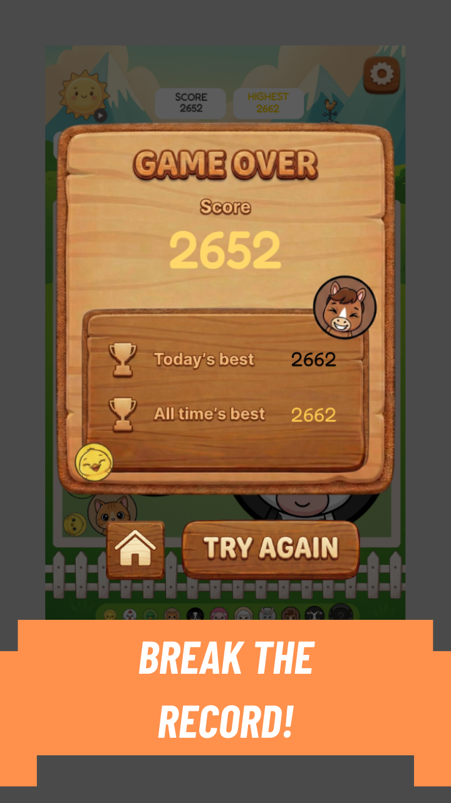

# 🐮 FarmFall

<p align="center">
  
</p>

<p align="center">
  <strong>A fun, colorful drop-and-match puzzle game featuring adorable farm animals!</strong>
</p>

<p align="center">
  <a href="https://play.google.com/store/apps/details?id=com.farmfall.gamename">
    
  </a>
  
  
</p>

## 🎮 About the Game

**FarmFall** is a mobile puzzle game where players drop adorable farm animals, merge matching ones, and aim for the highest possible score.

Designed around simple controls and colorful visuals, the game offers an easy-to-learn gameplay experience with a rewarding challenge: improve your timing, make strategic moves, and beat your records.

FarmFall is published on Google Play and was developed as an independent game project.

## ✨ Features

- 🐷 **Drop-and-Match Gameplay** — Drop animals and merge identical ones to score points.
- 🎯 **Simple Controls** — Easy-to-learn, tap-based gameplay.
- 🏆 **Daily Best Score** — Challenge yourself to beat your daily record.
- 📈 **All-Time High Score** — Keep track of your personal best.
- 🎨 **Colorful Farm Theme** — Cute animal characters and cheerful visuals.
- 📱 **Mobile-First Experience** — Designed for Android devices.
- 📴 **Offline Gameplay** — Play without requiring a constant internet connection.

## 📸 Screenshots

<p align="center">
  
  
  
</p>

<p align="center">
  
  
  
</p>

## 🛠️ Development

FarmFall was created using **GDevelop**, a game development engine that supports visual, event-based game logic.

The project involved working on gameplay mechanics, user interface screens, score tracking, visual presentation, and mobile release preparation.

### Key Development Areas

- Gameplay and merge mechanics
- User interface and screen design
- Score and record tracking
- Mobile game testing and publishing
- In-game advertising integration with Google AdMob

## 📂 Repository Structure

```text
FarmFall/
├── README.md
├── assets/
│   ├── logo.jpg
│   └── screenshots/
│       ├── gameplay-1.png
│       ├── gameplay-2.png
│       ├── gameplay-3.png
│       ├── gameplay-4.png
│       ├── gameplay-5.png
│       └── gameplay-6.png
└── FarmFall.json
```


## 🚀 Play FarmFall

Experience the game on Android:

**[Download FarmFall on Google Play](https://play.google.com/store/apps/details?id=com.farmfall.gamename)**

## 👨‍💻 Developer

Developed by **Mustafa Can** under the **JACS** name.

- GitHub: [@mustafacan402](https://github.com/mustafacan402)
- Game: [FarmFall on Google Play](https://play.google.com/store/apps/details?id=com.farmfall.gamename)

---

<p align="center">
  <i>Drop. Merge. Score. Repeat! 🌾</i>
</p>
